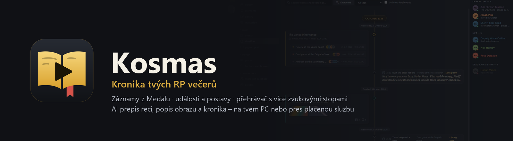
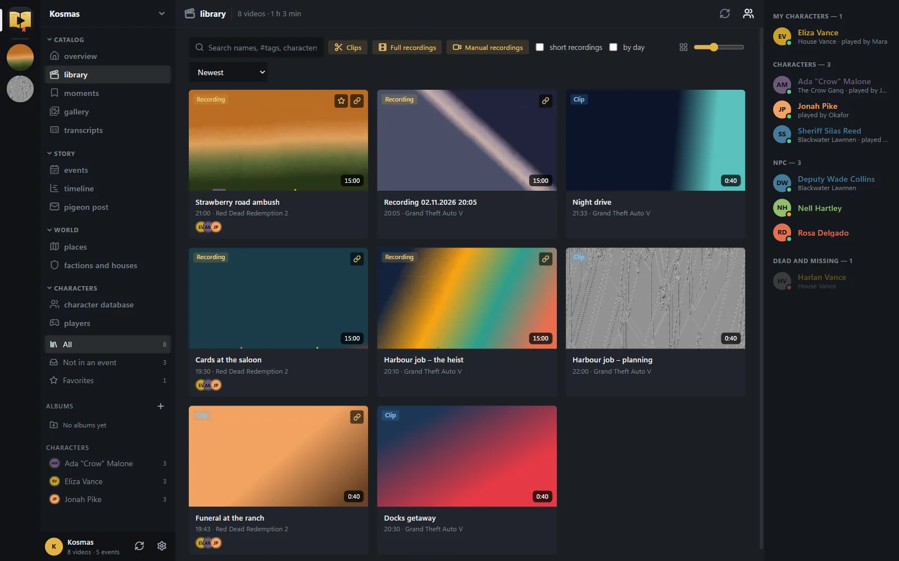
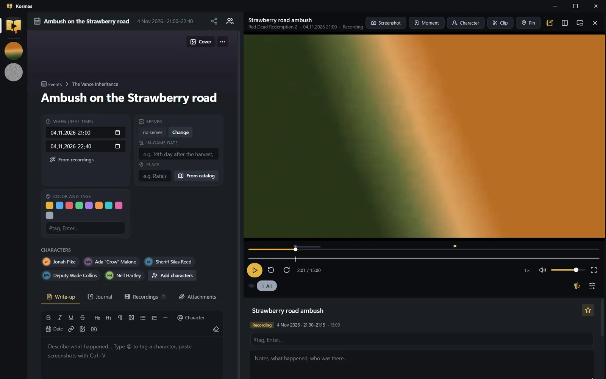
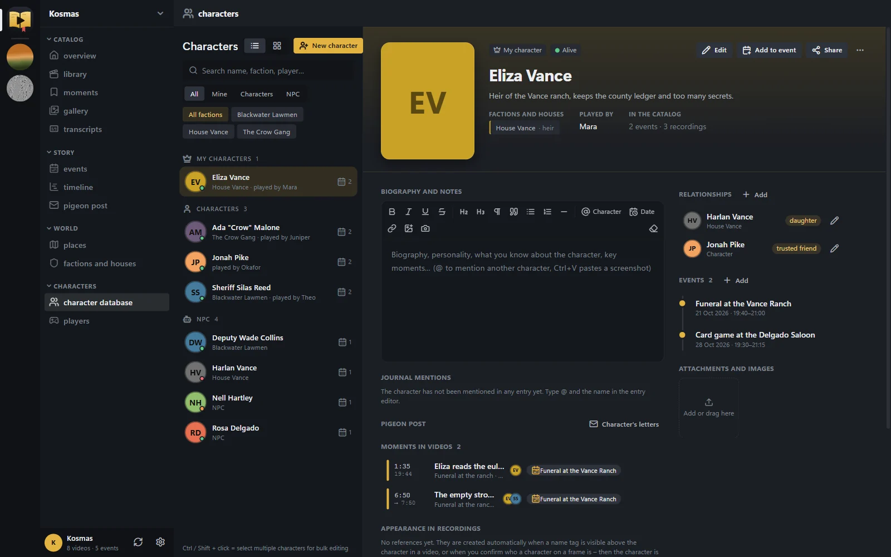
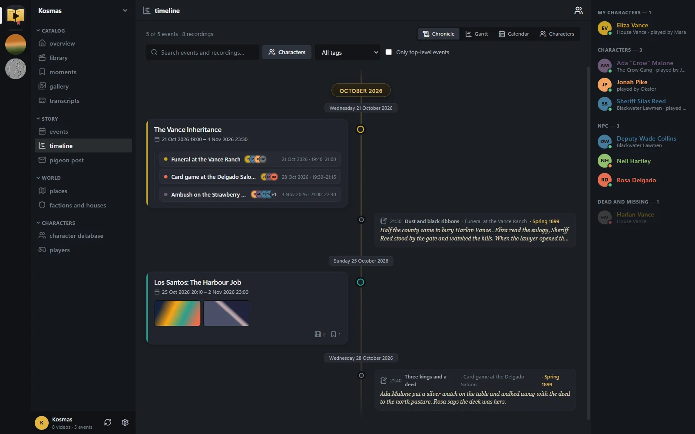

[English](README.md) · **Čeština**

<p align="center"></p>

<p align="center">
  <a href="https://github.com/gingygames/kosmas/releases/latest"><b>⬇ Stáhnout pro Windows</b></a> ·
  <a href="https://cosmas.gingygames.com">Web</a> · <a href="https://gingygames.com/kosmas/">Webová kronika</a> ·
  <a href="#instalace">Instalace</a> · <a href="#přihlášení-a-synchronizace-s-webem">Synchronizace</a> ·
  <a href="#ai-na-tvém-pc-nebo-placená-služba">AI</a> · <a href="#soukromí">Soukromí</a> · <a href="#sestavení-ze-zdrojových-kódů">Ze zdrojových kódů</a>
</p>

# Kosmas — kronika tvých RP večerů

**Kosmas** (dříve Kronikář, pojmenovaný po nejstarším českém kronikáři) je aplikace pro Windows, která z tvých záznamů z
[Medalu](https://medal.tv) udělá kroniku hraní rolí:
- **knihovna** záznamů a klipů podle her a večerů;
- **události** se zápisem, deníkem a přílohami na **časové ose** (kronika, Gantt, kalendář, dráhy postav);
- databáze **postav, frakcí a rodů, míst a hráčů** se vztahy a portréty;
- **momenty** – označená místa a úseky ve videích, přiřazené k událostem a postavám;
- **přehrávač**, který hraje víc zvukových stop najednou (hra, Discord, mikrofon);
- volitelně **AI**: přepis řeči, popis obrazu, jmenovky přečtené z obrazovky a návrh kroniky večera;
- volitelně **synchronizace s webovou kronikou** na [gingygames.com/kosmas](https://gingygames.com/kosmas/) – postavu nebo událost
  nasdílíš odkazem a postavy použiješ v komunitním botovi na Discordu.

Rozhraní je anglicky, nebo česky, když máš Windows v češtině či slovenštině (Nastavení → Obecné → Jazyk: Automaticky / English / Čeština).

| | |
|:-:|:-:|
|  **Knihovna** – záznamy a klipy, filtry, postavy v každém videu |  **Přehrávač** – víc zvukových stop, momenty, událost vedle videa |
|  **Postavy** – profil, frakce, vztahy, události a momenty |  **Časová osa** – příběh jako kronika, Gantt, kalendář nebo dráhy postav |

<sub>Snímky ukazují smyšlená ukázková data (anglické rozhraní).</sub>

## Stažení
> **Kosmas 1.2.0 je beta.** Je připravený na běžné používání, ale cokoli divného prosím nahlas přes **?** → *Nahlásit chybu* v záhlaví okna.

Stáhni **Cosmas-Setup-&lt;verze&gt;.exe** z [Releases → latest](https://github.com/gingygames/kosmas/releases/latest)
(odkaz je i na [cosmas.gingygames.com](https://cosmas.gingygames.com)). U každého vydání je vedle instalátoru soubor `.sha256`. 64bitové Windows 10 (1809 a novější) nebo Windows 11.

## Instalace
1. Spusť instalátor a klikni na **Další → Instalovat**.
   - Instaluje se jen pro tvého uživatele (`%LOCALAPPDATA%\Programs\Kronikar`): bez práv správce, bez Pythonu, nic dalšího –
     přehrávač (libmpv) i ffmpeg jsou uvnitř.
   - Zástupci se vytvoří v nabídce Start a na ploše (ten na ploše můžeš odškrtnout).
   - Instalátor zatím není digitálně podepsaný, takže Windows může ukázat *Systém Windows ochránil váš počítač* (SmartScreen).
     Klikni na **Další informace → Přesto spustit**. Jestli chceš mít jistotu, že je soubor pravý, porovnej jeho SHA-256 se souborem
     `.sha256` u vydání (PowerShell: `Get-FileHash .\Cosmas-Setup-<verze>.exe`).
2. **Aktualizace:** Kosmas sám hlídá nové verze (chvíli po spuštění a pak každých 12 hodin) a v záhlaví okna ukáže
   **Aktualizace x.y.z**. *Aktualizovat* stáhne instalátor na pozadí a ověří ho podle zveřejněného SHA-256, *Restartovat a nainstalovat*
   aplikaci řádně zavře, potichu nainstaluje novou verzi a znovu ji spustí. Nastavení → Obecné → Aktualizace: automatická kontrola,
   stahování na pozadí, kanál stabilní nebo beta, *Zkontrolovat*, *Tuhle verzi přeskočit*. Funguje i ruční spuštění novějšího
   instalátoru; data zůstanou a starší instalace (Kronikář 1.0, Kosmas 1.1) se aktualizují na místě včetně zástupců.
   Anglicky se aplikace jmenuje **Cosmas**, česky **Kosmas** – zástupce pojmenuje instalátor podle svého jazyka.
3. **Odinstalace:** *Nastavení Windows → Aplikace → Kosmas*. Zeptá se, jestli smazat i katalog (výchozí je ponechat).
   Smazání odstraní celou datovou složku: katalog, přílohy, data AI, vyexportované klipy i zálohy. Záznamů ve složkách s nahrávkami
   se odinstalace nikdy nedotkne.

## První spuštění
- Kosmas sám najde složky Medalu (`Videa\Medal`, `X:\Medal`). Další přidáš v **Nastavení → Knihovna**.
  Databázi Medalu jen čte, nikdy do ní nezapisuje.
- Katalog je v `%LOCALAPPDATA%\Kronikar` (catalog.db, nastavení, náhledy, přílohy, přepisy). Nastavení → Data a zálohy ukáže přesnou cestu
  a otevře ji. Katalog (catalog.db) se každý den sám zálohuje do `backups\` (ponechá se 7 nejnovějších).
- Pokud jsi Kosmase dřív spouštěl ze zdrojových kódů nebo z přenosné kopie, první spuštění ten katalog najde a **zeptá se**,
  jestli ho má zkopírovat. Původní složka se nikdy nepřesouvá ani nemění.
- Chceš si něco vyzkoušet a nezaneřádit kroniku? Označ záznamy jako testovací (⋯ → *Označit jako testovací záznam*): jsou skryté,
  dokud nezapneš **Nastavení → Web a synchronizace → Testovací data → Zobrazit testovací data**, nikdy se nesynchronizují a *Smazat testovací data* je
  odstraní (po záloze).

## Přihlášení a synchronizace s webem
Webová kronika na [gingygames.com/kosmas](https://gingygames.com/kosmas/) ukáže tvoje postavy, události, frakce a místa v prohlížeči
a umožní je sdílet.
1. **Nastavení → Web a synchronizace → Přihlásit se přes Discord.** Otevře se prohlížeč; přihlas se Discordem a klikni na **Povolit**. Nic se nekopíruje.
   (Když se prohlížeč nemůže vrátit do aplikace, použij zobrazený kód.)
2. **Synchronizovat teď** – nebo zaškrtni *Synchronizovat po startu aplikace*. Změny jdou oběma směry; když se tentýž záznam změnil na obou stranách,
   vybereš, která verze platí.
3. Všechno na webu je **soukromé**, dokud to nenasdílíš: tlačítko **Sdílet** u postavy, frakce, místa, události nebo momentu nabízí
   *Jen já*, *Kdo má odkaz* a *Veřejné*.
4. **Používat na Discordu** (v úpravách postavy) dá postavu jako kartu do komunitního bota na Discordu.
5. *Odhlásit / odpojit toto zařízení* zruší přístup zařízení; zařízení můžeš odpojit i na webu (Nastavení → Synchronizace).

## AI: na tvém PC, nebo placená služba
Při prvním přepisu si vybereš, kde má AI běžet. Najdeš to v **Přepisy → Kde běží AI**. Volbu jde kdykoli změnit, i zvlášť pro každou část.

**Na tomto PC: zdarma a soukromě.**
- Kosmas zjistí grafickou kartu, paměť a procesor. Doporučí modely, které tvoje PC zvládne (v nabídce jsou označené ★).
- Ollamu (pro obraz a kroniku) nainstaluje a modely stáhne jedním klikem.

**Placená služba: rychlé i na slabém PC.**
- U OpenRouteru se jen **přihlásíš v prohlížeči**. U ostatních vložíš **API klíč**; odkaz „Získat klíč“ vede rovnou na správnou stránku.
- Klíče se ukládají šifrovaně do Správce přihlašovacích údajů Windows.
- U každého modelu vidíš **odhad ceny za hodinu záznamu** i za celou nepřepsanou knihovnu.
- Stránka ukazuje i skutečnou útratu za posledních 30 dní.

| Služba | Řeč | Obraz | Kosmas AI | Poznámka |
|---|---|---|---|---|
| **Tento počítač** | Whisper (NVIDIA nebo procesor) | Ollama | Ollama | zdarma |
| **Groq** | Whisper large-v3 ≈ 7,7 Kč/h · turbo ≈ 2,8 Kč/h | Qwen 3.8 ≈ 12 Kč/h | GPT-OSS 120B ≈ 0,3 Kč/h | nejlevnější přepis řeči, má i bezplatnou úroveň |
| **Anthropic Claude** | – | Haiku 5.5 ≈ 1,4 · Sonnet 5.5 ≈ 28 · Opus 5.5 ≈ 57 Kč/h | Haiku ≈ 0,3 · Sonnet ≈ 6,7 · Opus ≈ 13 Kč/h | výborná čeština |
| **Google Gemini** | – | 3.5 Flash-Lite ≈ 4,4 Kč/h | ≈ 1,1 Kč/h | bezplatná úroveň s denním limitem |
| **OpenAI** | whisper-1 ≈ 25 Kč/h | GPT-5.4 nano ≈ 2,9 · mini ≈ 10 Kč/h | nano ≈ 0,7 · mini ≈ 2,5 Kč/h | |
| **OpenRouter** | – | modely Gemini a GPT | modely Gemini a GPT | přihlášení v prohlížeči, jeden účet pro víc firem |

<sub>Jsou to odhady za hodinu záznamu podle ceníků z listopadu 2026 (23 Kč/$). Počítají se 3 zvukovými stopami
a zhruba 150 popsanými snímky za hodinu. Řeč se platí za každou stopu zvlášť. Skutečná cena se liší podle nastavení a obsahu.</sub>

**Doporučení pro lokální AI podle grafické karty** (Kosmas vybere sám):

| Paměť grafické karty | Obraz i kronika (Ollama) | Řeč (Whisper) |
|---|---|---|
| 24 GB a víc | `qwen3.8:27b` (18 GB) | large-v3 na GPU, hodina za pár minut |
| 16 GB | `gemma4:12b-it-q8_0` | large-v3 na GPU |
| 10–12 GB | `gemma4:12b-it-qat` | large-v3 na GPU |
| 8 GB | `qwen3.5:9b` | large-v3 na GPU |
| 6 GB | `qwen3.5:4b` | large-v3 na GPU (NVIDIA) |
| 4 GB | `qwen3.5:2b` + `qwen3.5:4b` | large-v3-turbo na GPU (NVIDIA) |
| bez samostatné karty | malé modely, velmi pomalé, doporučena placená služba | medium/small na procesoru |

- Přepis řeči na grafické kartě umí jen NVIDIA. Knihovny CUDA (~1,5 GB) si Kosmas stáhne jedním klikem, když je potřeba.
- Na kartách AMD a Intel běží Ollama přes Vulkan. Řeč pak jde přes procesor nebo placenou službu.

## Rozložení
Jako v chatovacích aplikacích pro hráče: vlevo pruh s ikonami her (klik = knihovna hry s bannerem
a nahraným časem, nahoře „RP“ = celý katalog), vedle sloupec s kanály (Katalog / Příběh / Postavy,
strom událostí, filtry knihovny) a dole panel „Přehrává se“ s ovládáním přehrávače. Vpravo seznam
postav (klik = karta postavy); na stránce události jsou nahoře postavy z té události. Při úzkém
okně se seznam postav sám schová.

## Postavy, frakce a hráči
- **Profil postavy** se zobrazuje jen pro čtení, základní údaje upravíš tlačítkem **Upravit** (typ, rod muž/žena,
  stav, přezdívky, hráč, frakce, barva). U mrtvé nebo zmizelé postavy jde zadat datum (reálné i herní),
  poznámku a událost, kde se to stalo.
- **Vztahy** mají typy, které se skloňují podle rodu (milenec/milenka, manžel/manželka, otec/matka ↔ syn/dcera,
  lenní pán ↔ vazal, věřitel ↔ dlužník…), poznámku a jdou upravit. Vlastní text funguje dál.
- **Frakce a rody** – samostatné záznamy s erbem, typem (rod, frakce, cech, řád, město), historií a členy s rolí.
- **Hráči** – lidé za postavami, jeden hráč může mít víc postav. Štítky hráče (např. admin) se ukazují
  i u jeho postav a u momentů, kde jeho postavy jsou.
- **Hromadné úpravy** – Ctrl/Shift + klik v seznamu postav: typ, stav, frakce, hráč, barva, do události, smazat.

## Přehrávač – novinky
- Pod přehrávačem je panel s informacemi o přehrávaném videu (tlačítko se zápisníkem v hlavičce ho skryje).
- Najetí na časovou osu ukáže náhled snímku, pod osou je průběh hlasitosti každé zvukové stopy
  (vygeneruje se na pozadí při prvním přehrání, uloží se do `data/previews`).
- Předvolby zvukových stop (tlačítko s posuvníky, Ctrl+Shift+1…9) a výchozí stopy pro každou hru.
- Video pokračuje tam, kde jsi skončil (červený proužek na kartě, „Pokračovat ve sledování“ na Přehledu).
- `C` / tlačítko **Postava** označí, kdo je ve videu v tomto momentu.
- Snímky a obrázky z videí mají tlačítko „Přehrát video od …“.

## Obrazovky
- **Knihovna** – videa po dnech, filtry podle her/typu/alb/štítků/postav, hledání (Ctrl+F),
  vícenásobný výběr (Ctrl/Shift), přetažení na album nebo na událost, boční panel s úpravami.
- **Události** – strom událostí (přetahováním), stránka události: obálka, čas reálný i herní,
  místo, štítky, postavy s rolemi, **Zápis** (bohatý text), **Deník** (datované zápisy s přílohami),
  **Záznamy** (připojená videa + chytré návrhy), **Přílohy**, **Podudálosti**.
  „Navrhnout ze záznamů“ seskupí neroztříděná videa do herních večerů.
- **Postavy** – profil s portrétem, frakcí, stavem, hráčem, životopisem, vztahy, událostmi,
  videi a zmínkami v deníku.
- **Osa** – čtyři pohledy: Kronika, Osa (zoomovatelný Gantt), Kalendář, Postavy (dráhy).
- **Momenty** – všechny momenty a úseky (virtuální klipy) z videí, seskupené podle záznamu,
  filtr nepřiřazené / v událostech. Momenty označené v Medalu klávesou se načtou samy
  (automatické herní momenty typu „Double Kill“ jsou skryté, dají se zapnout).
- **Galerie** – všechny screenshoty a snímky z videí.
- **Nastavení** – jazyk (Automaticky / English / Čeština; automaticky = čeština, když je systém česky nebo slovensky, jinak angličtina), vzhled (7 motivů, barva zvýraznění, velikost rozhraní, zaoblení, písmo, animace,
  rozložení přehrávače), složky, pravidla klip/záznam, výchozí zvukové stopy, přejmenování her.

## Momenty a úseky
`B` = moment v aktuálním místě, `Shift+B` = začátek a pak konec úseku, `P` = moment rovnou do
události. Moment má název, poznámku, barvu, postavy a událost; úsek se přehraje a sám zastaví.
Najdeš je v Momentech, v inspektoru videa v Knihovně, u události (Záznamy → Momenty), u postavy
a na Ose jako praporky.

## Snímky a portréty
`S` / **Snímek** v přehrávači nabídne: celý snímek do události, výřez do události, nebo
**portrét postavy** (ořez 4:5 / 1:1 / 16:9 / volně). Portrét jde vyříznout i z profilu postavy.

## Editor textu
`@` označí postavu (nebo rovnou vytvoří novou), `Ctrl+V` vloží screenshot, tlačítka pro nadpisy,
citace, seznamy, datum a **snímek z přehrávače**.

## Přehrávač
Zvukové stopy jako přepínače (kolečko = hlasitost stopy, pravé tlačítko = posuvník / jen tato stopa),
posuvník se značkami momentů z Medalu (zlaté) a odkazů z událostí (červené).
**Snímek** uloží aktuální obraz do události, **Připnout** připojí okamžik videa k události.
Tlačítko vedle otevře přehrávač ve vlastním okně, F / dvojklik = celá obrazovka.
Další tlačítko přepne rozložení: přehrávač vedle obsahu, nebo nahoře s obsahem pod ním.
Dekódování videa běží na GPU (libmpv, `hwdec=auto-safe`, `vo=gpu-next`).

## Nastavení
Nastavení je rozdělené do sekcí s postranní nabídkou – **Obecné** (jazyk, vzhled, spouštění minimalizovaně, běh v oznamovací
oblasti, aktualizace), **Knihovna** (složky, hledání nových záznamů, dělení, názvy her), **Přehrávač** (výchozí stopy, pokračování
tam, kde jsi skončil, délky skoků, hlasitost až 200 %, hardwarové nebo softwarové dekódování), **Momenty a události**, **AI**,
**Web a synchronizace**, **Data a zálohy**, **Soukromí a diagnostika**, **Klávesové zkratky** a **O aplikaci**. Změny se ukládají hned.

## Zpětná vazba a hlášení chyb
Tlačítko **?** v záhlaví okna (nebo Nastavení → Soukromí a diagnostika) otevře **Poslat zpětnou vazbu / Nahlásit chybu**: vyber chybu,
nápad, dotaz nebo jiné, napiš zprávu, případně e-mail pro odpověď a zvol, co přiložit – konec logu, snímek okna aplikace, informace
o systému (verze Windows a aplikace, grafika, RAM). *Náhled* ukáže přesně to, co se odešle. Z logů se předtím odstraní tokeny, klíče,
e-mailové adresy a tvoje uživatelská složka. Dostaneš číslo hlášení; bez internetu hlášení počká a odešle se později. Po nečekané
chybě aplikace sama nabídne poslat hlášení s podrobnostmi.

## Data
- Vše, co upravíš, je v datové složce: po instalaci `%LOCALAPPDATA%\Kronikar`, při spuštění ze zdrojových kódů `data/`.
  Jsou v ní catalog.db, settings.json, thumbs/, attachments/, analysis/, backups/ a logs/.
- **Zálohy:** catalog.db se zálohuje automaticky (denně, ponechá se 7 nejnovějších; obojí jde změnit) a tlačítkem *Zálohovat teď*.
  *Obnovit…* vrátí zálohu po restartu; nahrazovaný katalog se předtím sám zazálohuje. Přílohy a náhledy jsou samostatné soubory –
  pro úplnou zálohu zkopíruj celou složku. *Exportovat jako JSON…* zapíše všechny tabulky do jednoho souboru.
- **Logy:** `logs\cosmas.log` (rotuje, nejvýš pár MB); Nastavení → Soukromí a diagnostika otevře složku nebo zkopíruje diagnostiku.
- Databázi Medalu aplikace jen čte. Mazání videí posílá soubory do Koše.
- `extras/multitrack-mix.lua` – samostatný skript pro obyčejné mpv.

## Discord
- **Hráči bez serveru:** stačí token bota (bot nemusí být nikde pozvaný) a u hráče „Propojit podle ID“ – stáhne jméno
  a avatar z veřejného profilu. Discord ID: Nastavení → Pokročilé → Režim vývojáře, pravý klik → Kopírovat ID uživatele.
- **Hráči ze serveru:** Nastavení → Web a synchronizace → Discord: token bota + ID serveru → „Načíst členy a vytvořit hráče“ (jméno a avatar),
  u hráče „Propojit s Discordem“, „Aktualizovat jména a avatary“. Bot potřebuje zapnutý *Server Members Intent*.
- **Holubí pošta ze schránky (PM):** v Discordu označ zprávy tažením myši, Ctrl+C, v Holubí poště Ctrl+V
  (nebo Přidat → Vložit ze schránky). Rozpozná autora, čas a text, předvybere zprávy se slovem „holub“,
  autora přiřadí k postavě podle hráče, opakované vložení nevytvoří duplikáty.
- **Holubí pošta:** dopisy (zprávy se slovem „holub“, slovo jde změnit) z kanálu na serveru přes bota
  (*Message Content Intent*), z oficiálního exportu dat Discordu (jen tvé vlastní zprávy), nebo ručně.
  Cizí soukromé zprávy Discord automaticky nevydá – boti k nim nemají přístup a automatizace osobního účtu
  je proti pravidlům Discordu.

## Svět, servery a klipy
- **Servery:** pod každou hrou (levý pruh) jde přidat servery s obdobím, kdy se na nich hrálo – videa se přiřadí
  sama; výběr serveru filtruje knihovnu, události, postavy, frakce, místa i osu. Nové věci se zakládají
  do vybraného serveru.
- **Místa:** hrady, města, krčmy… s vlastníkem (postava / frakce = državy), nadřazeným místem a událostmi.
- **Vzhled podle frakce:** postava bez vlastní barvy převezme barvu a erb první frakce.
- **Klipování:** `I` začátek, `O` konec (okraje jdou táhnout na ose) → Přehrát výběr / Uložit klip /
  Export MP4 (všechny zvukové stopy, do `data/clips`). `T` = aktuální snímek jako náhled videa.
  Označení postavy v momentu je teď `C`.

## Přepisy, obraz a Kosmas AI podrobně
Když AI běží na tvém PC, nic se nikam neposílá. S placenou službou jde zvuk (řeč) nebo snímky a text přepisu jen té zvolené službě.
- **Spuštění:** v panelu videa sekce **Přepis**, pro víc videí pravý klik → Přepis, pro celou knihovnu stránka
  **Přepisy** → „Přepsat chybějící“. Fronta běží na pozadí jedno video po druhém; po přerušení (i zavření aplikace)
  naváže, kde skončilo.
- **Řeč:** každá zvuková stopa zvlášť – **Já** (mikrofon), **Hra** (hlasový chat ve hře, NPC), **Discord**.
- **Obraz:** hlavně během rozhovorů – když se scéna mění (chůze po světě), snímek každých ~8 s; když postavy sedí
  a obraz se nemění, jen občas. Model čte **jmenovky nad postavami** (propojí je s postavami a hráči) a při rozhovorech
  se hledají **tváře** – klik na tvář ji nastaví jako portrét postavy. Jakýkoli úsek jde dopracovat ručně:
  na pruhu pokrytí v panelu videa táhni myší → „Popsat obraz“.
- **Poznávání postav podle vzhledu:** model obrazu označí každou postavu na snímku (rámeček, jmenovka nad hlavou,
  popis oblečení a vlasů); z výřezu se spočítá otisk oblečení/vlasů (DINOv2) a obličeje (SFace). Postavy se jmenovkou
  nebo potvrzené tebou (klik na postavu u snímku → „Ano, je to…“ / „Kdo to je…“) jsou vzory, ostatní se poznají
  podle podobnosti – vzory ze stejného večera mají přednost, starší váží méně (oblečení se mění). U postavy je galerie
  „Vzhled v záznamech“. Modely (~130 MB) se stáhnou do `data/models` při prvním použití a běží na procesoru.
- **Kosmas AI:** po přepisu projde záznam silnější textový model po blocích (dělených v pauzách mezi rozhovory,
  pauzy jsou v textu vyznačené) s průběžnou pamětí děje, se shrnutím předchozího večera stejné hry a se znalostí
  postav, míst a frakcí z databáze. Vytvoří kapitoly, shrnutí večera, zmínky (uloží se rovnou k postavám, místům,
  frakcím) a **návrhy** nových událostí, postav, míst a frakcí – přijímají se jedním klikem (stránka Přepisy → Návrhy,
  nebo v panelu videa); událost dostane odkaz do videa s časem, místo a postavy.
- **Kde to je vidět:** pruh pokrytí (co je přepsané / popsané / nezpracované), přepis s kapitolami, pauzami,
  zvýrazněnými jmény, náhledy snímků, jmenovkami a tvářemi; na kartách v Knihovně ikony řeči a obrazu; hledání
  v Knihovně podle toho, co zaznělo; u postav, míst a frakcí sekce „V záznamech (přepis)“; titulky v přehrávači (V).
- **Fronta a výkon:** stránka **Přepisy** – aktuální video s krokem, průběhem, odhadem času a rychlostí, pořadí fronty
  (přetažením), historie, vytížení GPU/VRAM/teploty/CPU/RAM. Ukazatel v levém sloupci. Když hraješ (hra ze Steamu,
  Epicu, Xboxu, GOG… nebo z nastaveného seznamu), přepisy se samy pozastaví a po hře pokračují.
- **Nastavení:** Přepisy → Kde běží AI (služby, modely, účty, ceny) a Přepisy → Nastavení (jazyk, stopy, hustota snímků, citlivost, jmenovky, tváře, model a délka
  bloků Kosmas AI, kontext o hře a serveru, priorita, pauza při hraní).
- Výsledky: `analysis/<id>/` v datové složce (přepis po částech, snímky, tváře, `chronicle.json`, `timeline.md` – celý večer jako text).
- Rychlost na RTX 4090: řeč ~45× rychleji než reálný čas, popis snímku 3–9 s, Kosmas AI ~1 min na blok.

## Obrázky her
Ikony v levém pruhu a bannery knihovny se při prvním spuštění samy doplní ze Steamu v tomto PC.
Jinak pravý klik na ikonu hry → „Ikona a banner hry…“: Steam v PC (obal, logo, hero), obchod Steam (hledání),
ikony z Medalu, soubor, URL, schránka nebo snímek z videa – vše s ořezem.

## Výchozí hodnoty
- Server: když má hra jediný server, je výchozí; jinak pravý klik na server → „Nastavit jako výchozí“. Videa bez
  serveru i nové postavy, události, frakce a místa (když je vybraná hra) dostanou výchozí server.
- Nová postava má typ „Postava“ (dřív NPC). Hromadné úpravy postav: Ctrl/Shift + klik a pravé tlačítko.

## Sestavení ze zdrojových kódů
**Technika:**
- Python 3.12 + PySide6. Rozhraní je v `rpcatalog/web/` a běží offline v Qt WebEngine.
- Přehrávač je libmpv (`vendor/libmpv-2.dll`), ikony jsou Lucide, na náhledy slouží ffmpeg/ffprobe.
- Most mezi Pythonem a webem: `rpcatalog/api.py` (QWebChannel).
- Překlady: `rpcatalog/i18n.py` a `rpcatalog/web/i18n.js`; české texty jsou v `rpcatalog/web/i18n/cs.js`, klíčem je anglický zdrojový text.
- AI:
  - `rpcatalog/analysis.py`: zpracování videí, běží jako samostatný proces;
  - `ai_providers.py`: lokální i placené služby a ceník;
  - `hardware.py`: zjištění hardwaru a doporučení modelů;
  - `keystore.py`: klíče ve Správci přihlašovacích údajů;
  - `ai_setup.py`: přihlášení, instalace Ollamy a stahování modelů.

**Spuštění ze zdrojových kódů**
1. Nainstaluj Python 3.12 a v kořeni projektu spusť:
   ```
   python -m venv .venv
   .venv\Scripts\pip install -r requirements.txt -r requirements-ai.txt anthropic
   ```
2. Stáhni `mpv-dev-x86_64-…7z` z [shinchiro/mpv-winbuild-cmake](https://github.com/shinchiro/mpv-winbuild-cmake/releases) a soubor `libmpv-2.dll` z něj dej do složky `vendor/`.
   Do gitu se nenahrává, má přes 100 MB.
3. Dej ffmpeg/ffprobe na PATH (`winget install Gyan.FFmpeg`).
4. Spusť `Kronikar.bat`. Data jsou pak ve složce `data/` vedle kódu; proměnná `KRONIKAR_DATA` nastaví jinou (třeba prázdnou testovací) složku.
5. Testy: `python -m unittest discover -s tests` (testy synchronizace potřebují lokální webový backend, jinak se přeskočí).

**Sestavení instalátoru:** spusť `.venv\Scripts\python.exe installer\build.py`. Skript:
1. stáhne vestavěný Python 3.12;
2. přibalí balíčky z `installer/requirements-dist.txt`, libmpv, ffmpeg a spouštěč `Kronikar.exe` s ikonou;
3. přes Inno Setup vytvoří `build/Cosmas-Setup-<verze>.exe`. Verze se bere z `rpcatalog/__init__.py`.

Ikonu z `rpcatalog/web/icon.svg` přegeneruje `installer/make_icon.py`.

## Soukromí
Kosmas je **local first**: katalog je soubor SQLite na tvém PC a všechno funguje offline.
- **Nic se nenahrává, dokud se nepřihlásíš a nesynchronizuješ.** Pak jde na web jen kronika (postavy, frakce, místa, jména hráčů,
  události, zápisy, momenty, obrázky, které jsi přiložil, názvy videí a odkazy na YouTube). Soubory videí se nenahrávají nikdy; u lokálního
  videa se posílá jen název, délka a cesta relativní ke složce se záznamy. Kontakty hráčů a tokeny botů neopustí tvoje PC;
  holubí pošta jen když ji zaškrtneš. Testovací záznamy se nesynchronizují nikdy.
- Co synchronizuješ, je na webu soukromé, dokud to nenasdílíš.
- **AI na tomto PC** nechá všechno v PC. U **placené služby** jde do vybrané služby jen zvuk (řeč) nebo snímky a text přepisu;
  API klíče jsou šifrovaně ve Správci přihlašovacích údajů Windows.
- Databázi Medalu Kosmas jen čte; smazané video jde do Koše.
- **Kontrola aktualizací** se gingygames.com (nebo GitHubu) ptá jen na nejnovější verzi; nic o tobě se neposílá. **Hlášení** se posílá
  jen když ho sám odešleš, a přesně to, co ukáže náhled.

## Licence
Repozitář zatím nemá soubor s licencí, takže ke kódu žádná licence udělená není. Přibalené komponenty mají vlastní licence:
libmpv (mpv), FFmpeg (GPL build), Qt/PySide6 (LGPL), ikony Lucide (ISC).

## Odkazy
- Web: https://cosmas.gingygames.com
- Webová kronika: https://gingygames.com/kosmas/
- Stažení: https://github.com/gingygames/kosmas/releases/latest
- Chyby a nápady: https://github.com/gingygames/kosmas/issues
