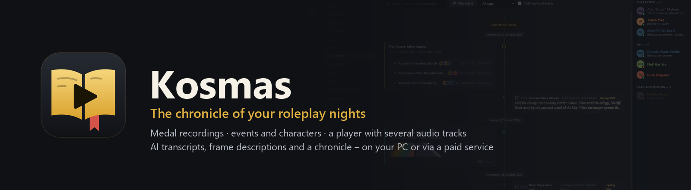
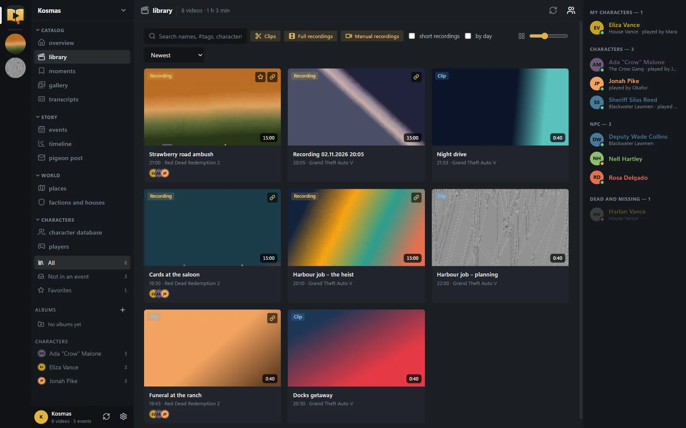
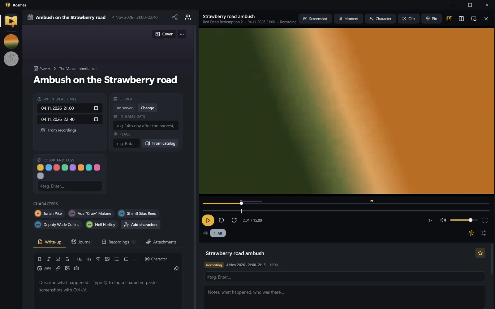
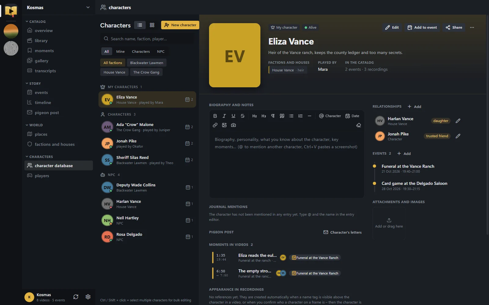
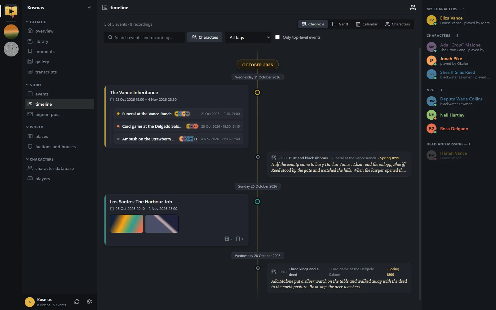

**English** · [Čeština](README.cs.md)

<p align="center"></p>

<p align="center">
  <a href="https://github.com/gingygames/kosmas/releases/latest"><b>⬇ Download for Windows</b></a> ·
  <a href="https://gingygames.com/kosmas/">Web chronicle</a> ·
  <a href="#install">Install</a> · <a href="#sign-in-and-sync-with-the-web">Sync</a> ·
  <a href="#ai-on-your-pc-or-a-paid-service">AI</a> · <a href="#privacy">Privacy</a> · <a href="#build-from-source">Build from source</a>
</p>

# Kosmas — the chronicle of your roleplay nights

**Kosmas** (formerly Kronikář, named after Cosmas of Prague, the oldest Czech chronicler) is a Windows app that turns your
[Medal](https://medal.tv) recordings into a roleplay chronicle:
- a **library** of your recordings and clips, grouped by game and evening;
- **events** with a write-up, a dated journal and attachments, on a **timeline** (chronicle, Gantt, calendar, character lanes);
- a database of **characters, factions and houses, places and players**, with relationships and portraits;
- **moments** – marked points and segments in videos, attached to events and characters;
- a **player** that plays several audio tracks at once (game, Discord, microphone);
- optional **AI**: speech transcripts, frame descriptions, name tags read from the screen and a suggested chronicle of the evening;
- optional **sync with the web chronicle** at [gingygames.com/kosmas](https://gingygames.com/kosmas/) – share a character or an event by link,
  or use your characters with the community Discord bot.

The interface is in English, or in Czech when Windows is set to Czech or Slovak (Settings → Language: Automatic / English / Čeština).

| | |
|:-:|:-:|
|  **Library** – recordings and clips, filters, characters in each video |  **Player** – several audio tracks, moments, the event next to the video |
|  **Characters** – profile, factions, relationships, events and moments |  **Timeline** – the story as a chronicle, Gantt chart, calendar or character lanes |

<sub>Screenshots use made-up demo data.</sub>

## Download
Get **Kosmas-Setup-&lt;version&gt;.exe** from [Releases → latest](https://github.com/gingygames/kosmas/releases/latest)
(also linked from [gingygames.com/kosmas](https://gingygames.com/kosmas/)). 64-bit Windows 10 (1809 or newer) or Windows 11.

## Install
1. Run the installer and click **Next → Install**.
   - It installs for your user only (`%LOCALAPPDATA%\Programs\Kronikar`): no admin rights, no Python, nothing else needed –
     the video player (libmpv) and ffmpeg are bundled.
   - Shortcuts go to the Start menu and to the desktop (you can untick the desktop one).
2. **Updating:** run a newer installer. It replaces the program and keeps your data; an existing 1.0 install (Kronikář) is updated
   in place and its old shortcuts are replaced.
3. **Uninstalling:** *Windows Settings → Apps → Kosmas*. You're asked whether to delete your catalogue too (default: keep it);
   your videos are never deleted.

## First run
- Kosmas looks for your Medal folders by itself (`Videos\Medal`, `X:\Medal`). Add other folders in **Settings → Recording folders**.
  Medal's own database is only ever read, never written.
- Your catalogue lives in `%LOCALAPPDATA%\Kronikar` (catalog.db, settings, thumbnails, attachments, transcripts). Back this folder up;
  Settings → Catalog data shows the exact path and opens it.
- If you used Kosmas before from a source checkout or a portable copy, the first start finds that catalogue and **asks** whether to copy
  it in. The original folder is never moved or changed.
- Want to try things out without cluttering your chronicle? Mark records as test data (⋯ → *Mark as test record*): they are hidden
  unless **Settings → Test data → Show test data** is on, they never sync, and *Delete test data* removes them (after a backup).

## Sign in and sync with the web
The web chronicle at [gingygames.com/kosmas](https://gingygames.com/kosmas/) shows your characters, events, factions and places in the
browser and lets you share them.
1. **Settings → Web chronicle → Sign in with Discord.** Your browser opens; sign in with Discord and click **Allow**. Nothing to copy.
   (If the browser can't return to the app, use the code shown instead.)
2. **Sync now** – or tick *Sync after the app starts*. Changes go both ways; when both sides changed the same record you choose which wins.
3. Everything on the web is **private** until you share it: the **Share** button on a character, faction, place, event or moment offers
   *Only me*, *Anyone with the link* or *Public*.
4. **Use on Discord** (in a character's Edit form) puts the character on the community Discord bot as a card.
5. *Sign out / disconnect this device* revokes the device's access; you can also disconnect devices on the web (Settings → Sync).

## AI: on your PC, or a paid service
The first time you transcribe something, you choose where the AI should run. The choice lives in **Transcripts → Where AI runs**, and you can change it at any time, even separately for each part (speech, vision, chronicle).

**On this PC: free and private.**
- Kosmas detects your graphics card, memory and CPU and recommends models your PC can handle (marked with ★ in the list).
- It installs Ollama (used for vision and the chronicle) and downloads models with a single click.

**Paid service: fast, even on a weak PC.**
- With OpenRouter you just **sign in through your browser**. For the others you paste an **API key**; the "Get key" link takes you straight to the right page.
- Keys are stored encrypted in Windows Credential Manager.
- Each model shows an **estimated cost per hour of recording**, as well as for your entire untranscribed library.
- The page also shows what you actually spent over the last 30 days.

| Service | Speech | Vision | Kosmas AI | Notes |
|---|---|---|---|---|
| **This computer** | Whisper (NVIDIA or CPU) | Ollama | Ollama | free |
| **Groq** | Whisper large-v3 ≈ $0.33/h · turbo ≈ $0.12/h | Qwen 3.8 ≈ $0.52/h | GPT-OSS 120B ≈ $0.01/h | cheapest speech transcription, also has a free tier |
| **Anthropic Claude** | – | Haiku 5.5 ≈ $0.06 · Sonnet 5.5 ≈ $1.20 · Opus 5.5 ≈ $2.50/h | Haiku ≈ $0.01 · Sonnet ≈ $0.29 · Opus ≈ $0.57/h | excellent Czech |
| **Google Gemini** | – | 3.5 Flash-Lite ≈ $0.19/h | ≈ $0.05/h | free tier with a daily limit |
| **OpenAI** | whisper-1 ≈ $1.10/h | GPT-5.4 nano ≈ $0.13 · mini ≈ $0.43/h | nano ≈ $0.03 · mini ≈ $0.11/h | |
| **OpenRouter** | – | Gemini and GPT models | Gemini and GPT models | browser sign-in, one account for several providers |

<sub>Estimates per hour of recording, based on November 2026 price lists (the app shows prices in CZK; converted here at 23 CZK/$).
They assume 3 audio tracks and roughly 150 described frames per hour. Speech is billed per track. Actual cost depends on your settings and content.</sub>

**Recommended local AI by graphics card** (Kosmas picks this for you):

| Graphics memory (VRAM) | Vision and chronicle (Ollama) | Speech (Whisper) |
|---|---|---|
| 24 GB or more | `qwen3.8:27b` (18 GB) | large-v3 on GPU, an hour of recording in a few minutes |
| 16 GB | `gemma4:12b-it-q8_0` | large-v3 on GPU |
| 10–12 GB | `gemma4:12b-it-qat` | large-v3 on GPU |
| 8 GB | `qwen3.5:9b` | large-v3 on GPU |
| 6 GB | `qwen3.5:4b` | large-v3 on GPU (NVIDIA) |
| 4 GB | `qwen3.5:2b` + `qwen3.5:4b` | large-v3-turbo on GPU (NVIDIA) |
| no dedicated card | small models, very slow; a paid service is recommended | medium/small on CPU |

- GPU speech transcription works on NVIDIA only. Kosmas downloads the CUDA libraries (~1.5 GB) with one click when needed.
- On AMD and Intel cards, Ollama runs via Vulkan; speech then goes through the CPU or a paid service.

## Layout
It's laid out like the chat apps gamers use: on the left, a strip of game icons (click = that game's library with its banner
and total recorded time; "RP" at the top = the whole catalog); next to it, a channel column (Catalog / Story / Characters,
the event tree, library filters), with a "Now playing" panel and player controls at the bottom. On the right is the character
list (click = character card); on an event page, that event's characters are listed at the top. When the window gets narrow,
the character list hides itself.

## Characters, factions and players
- **Character profiles** are read-only by default; edit the basics with the **Edit** button (type, gender male/female,
  status, nicknames, player, faction, color). For a dead or missing character you can record the date (real-world and in-game),
  a note, and the event where it happened.
- **Relationships** have types that adapt to gender (lover, husband/wife, father/mother ↔ son/daughter,
  liege ↔ vassal, creditor ↔ debtor…), can carry a note and can be edited. Free-form text still works too.
- **Factions and houses** are records of their own, with a coat of arms, a type (house, faction, guild, order, town), a history and members with roles.
- **Players** are the people behind the characters; one player can have several characters. A player's tags (e.g. admin) also show up
  on their characters and on moments those characters appear in.
- **Bulk editing**: Ctrl/Shift + click in the character list to change type, status, faction, player or color, add to an event, or delete.

## Player – what's new
- Below the player there's a panel with details about the current video (the notebook button in the header hides it).
- Hovering over the timeline shows a frame preview; under the timeline you see the volume waveform of each audio track
  (generated in the background the first time you play a video and saved to `data/previews`).
- Audio track presets (the sliders button, Ctrl+Shift+1…9) and default tracks for each game.
- Videos resume where you left off (red progress bar on the card, "Continue watching" on the Overview).
- `C` / the **Character** button tags who is in the video at this moment.
- Snapshots and images taken from videos have a "Play video from …" button.

## Screens
- **Library** – videos grouped by day, filters by game/type/album/tag/character, search (Ctrl+F),
  multi-select (Ctrl/Shift), drag onto an album or event, side panel for editing.
- **Events** – an event tree (rearrange by dragging) and the event page: cover image, real-world and in-game time,
  place, tags, characters with roles, **Write-up** (rich text), **Journal** (dated entries with attachments),
  **Recordings** (attached videos + smart suggestions), **Attachments**, **Sub-events**.
  "Suggest from recordings" groups unsorted videos into game sessions.
- **Characters** – a profile with portrait, faction, status, player, biography, relationships, events,
  videos and journal mentions.
- **Timeline** – four views: Chronicle, Timeline (zoomable Gantt chart), Calendar, Characters (lanes).
- **Moments** – all moments and segments (virtual clips) from your videos, grouped by recording,
  with an unassigned / in events filter. Moments you mark in Medal with a hotkey are imported automatically
  (automatic game moments such as "Double Kill" are hidden, but can be turned on).
- **Gallery** – all screenshots and snapshots from videos.
- **Settings** – language (Automatic / English / Čeština; Automatic means Czech when your system language is Czech or Slovak,
  English otherwise), appearance (7 themes, accent color, interface size, corner rounding, font, animations,
  player layout), folders, clip/recording rules, default audio tracks, game renaming.

## Moments and segments
`B` = moment at the current position, `Shift+B` = start and then end of a segment, `P` = moment straight into an
event. A moment has a name, note, color, characters and event; a segment plays and then stops on its own.
You'll find them in Moments, in the video inspector in the Library, on events (Recordings → Moments), on characters,
and as little flags on the Timeline.

## Snapshots and portraits
`S` / **Snapshot** in the player offers: the whole frame into an event, a cropped area into an event, or a
**character portrait** (crop 4:5 / 1:1 / 16:9 / free). You can also crop a portrait from the character profile.

## Text editor
`@` mentions a character (or creates a new one on the spot), `Ctrl+V` pastes a screenshot, and there are buttons for headings,
quotes, lists, the date and a **snapshot from the player**.

## Player
Audio tracks are toggles (scroll wheel = track volume, right-click = slider / solo this track),
and the seek bar carries markers for Medal moments (gold) and event links (red).
**Snapshot** saves the current frame to an event; **Pin** attaches the current moment of the video to an event.
The button next to them pops the player out into its own window; F / double-click = full screen.
Another button switches the layout: player beside the content, or on top with the content below.
Video decoding runs on the GPU (libmpv, `hwdec=auto-safe`, `vo=gpu-next`).

## Data
- Everything you edit is stored in the data folder: `%LOCALAPPDATA%\Kronikar` when installed, `data/` when running from source.
  It holds catalog.db, settings.json, thumbs/, attachments/ and analysis/. Back it up.
- Medal's database is only ever read. Deleting videos moves the files to the Recycle Bin.
- `extras/multitrack-mix.lua` – a standalone script for plain mpv.

## Discord
- **Players without a server:** all you need is a bot token (the bot doesn't have to be invited anywhere) and "Link by ID" on the player – it pulls
  the name and avatar from the public profile. To get a Discord ID: Settings → Advanced → Developer Mode, then right-click → Copy User ID.
- **Players from a server:** Settings → Discord: bot token + server ID → "Load members and create players" (name and avatar),
  then "Link with Discord" on a player, and "Update names and avatars". The bot needs the *Server Members Intent* enabled.
- **Pigeon post from the clipboard (DMs):** in Discord, select messages by dragging the mouse, press Ctrl+C, then Ctrl+V in Pigeon post
  (or Add → Paste from clipboard). It recognizes the author, time and text, preselects messages containing the marker word ("holub" = pigeon by default),
  matches the author to a character via their player, and pasting the same thing twice won't create duplicates.
- **Pigeon post:** letters (messages containing the word "holub"; the keyword can be changed) from a server channel via a bot
  (*Message Content Intent*), from Discord's official data export (your own messages only), or entered by hand.
  Discord won't hand over other people's private messages automatically – bots have no access to them, and automating a personal account
  is against Discord's rules.

## World, servers and clips
- **Servers:** under each game (left strip) you can add servers along with the period you played on them – videos are assigned
  automatically; selecting a server filters the library, events, characters, factions, places and the timeline. New items are created
  in the selected server.
- **Places:** castles, towns, taverns… with an owner (character / faction = holdings), a parent place, and events.
- **Faction styling:** a character without its own color takes the color and coat of arms of its first faction.
- **Clipping:** `I` start, `O` end (the edges can be dragged on the timeline) → Play selection / Save clip /
  Export MP4 (all audio tracks, into `data/clips`). `T` = use the current frame as the video thumbnail.
  Tagging a character at a moment is now `C`.

## Transcripts, vision and Kosmas AI in detail
When AI runs on your PC, nothing leaves it. With a paid service, only the audio (speech) or frames and transcript text go to the service you picked.
- **Starting:** the **Transcript** section in the video panel; for several videos, right-click → Transcript; for the whole library, the
  **Transcripts** page → "Transcribe missing". The queue runs in the background, one video at a time; if it's interrupted (even by closing the app),
  it picks up where it left off.
- **Speech:** each audio track separately – **Me** (microphone), **Game** (in-game voice chat, NPCs), **Discord**.
- **Vision:** focused on conversations – when the scene keeps changing (walking around the world), a frame every ~8 s; when characters are sitting
  and the picture doesn't change, only occasionally. The model reads **name tags above characters** (linking them to characters and players), and during
  conversations it looks for **faces** – click a face to set it as the character's portrait. Any stretch can be refined by hand:
  drag across the coverage bar in the video panel → "Describe frames".
- **Recognizing characters by appearance:** the vision model marks every character in a frame (bounding box, name tag above the head,
  description of clothing and hair); from each crop, a clothing/hair fingerprint (DINOv2) and a face fingerprint (SFace) are computed. Characters with a name tag
  or confirmed by you (click a character next to a frame → "Yes, it's…" / "Who is this…") serve as references; everyone else is recognized
  by similarity – references from the same evening take priority, older ones count for less (outfits change). Each character has an
  "Appearance in recordings" gallery. The models (~130 MB) are downloaded to `data/models` on first use and run on the CPU.
- **Kosmas AI:** after transcription, a stronger text model works through the recording in blocks (split at pauses between conversations;
  the pauses are marked in the text), keeping a running memory of the story, a summary of the previous session of the same game, and knowledge of
  the characters, places and factions in your database. It produces chapters, a session summary, mentions (saved straight onto characters, places and
  factions) and **suggestions** for new events, characters, places and factions – each accepted with one click (Transcripts page → Suggestions,
  or in the video panel); the event gets a timestamped link into the video, a place and characters.
- **Where you see it:** the coverage bar (what's transcribed / described / unprocessed), the transcript with chapters, pauses,
  highlighted names, frame thumbnails, name tags and faces; speech and vision icons on Library cards; Library search
  by what was said; an "In recordings (transcript)" section on characters, places and factions; subtitles in the player (V).
- **Queue and performance:** the **Transcripts** page – the current video with its step, progress, time estimate and speed, the queue order
  (drag to reorder), history, and GPU/VRAM/temperature/CPU/RAM load. There's also an indicator in the left column. While you're playing (a game from Steam,
  Epic, Xbox, GOG… or from a list you set), transcription pauses itself and resumes after you finish.
- **Settings:** Transcripts → Where AI runs (services, models, accounts, prices) and Transcripts → Settings (language, tracks, frame density, sensitivity, name tags, faces, Kosmas AI model and
  block length, context about the game and server, priority, pause while gaming).
- Output: `analysis/<id>/` in the data folder (transcript in parts, frames, faces, `chronicle.json`, `timeline.md` – the whole session as text).
- Speed on an RTX 4090: speech ~45× faster than real time, 3–9 s to describe a frame, Kosmas AI ~1 min per block.

## Game artwork
Icons in the left strip and library banners are filled in automatically from Steam on this PC the first time you launch the app.
Otherwise, right-click a game icon → "Game icon and banner…": Steam on this PC (cover, logo, hero), the Steam store (search),
Medal icons, a file, a URL, the clipboard or a frame from a video – all with cropping.

## Defaults
- Server: if a game has only one server, it's the default; otherwise right-click a server → "Set as default". Videos without a
  server, as well as new characters, events, factions and places (when a game is selected), get the default server.
- A new character's type is "Character" (previously NPC). Bulk character editing: Ctrl/Shift + click, then right-click.

## Build from source
**Tech stack:**
- Python 3.12 + PySide6. The UI lives in `rpcatalog/web/` and runs offline in Qt WebEngine.
- The player is libmpv (`vendor/libmpv-2.dll`), icons are Lucide, and thumbnails are made with ffmpeg/ffprobe.
- Bridge between Python and the web UI: `rpcatalog/api.py` (QWebChannel).
- Translations: `rpcatalog/i18n.py` and `rpcatalog/web/i18n.js`; Czech strings live in `rpcatalog/web/i18n/cs.js`, keyed by the English source text.
- AI:
  - `rpcatalog/analysis.py`: video processing, runs as a separate process;
  - `ai_providers.py`: local and paid services, plus the price list;
  - `hardware.py`: hardware detection and model recommendations;
  - `keystore.py`: keys in Windows Credential Manager;
  - `ai_setup.py`: sign-in, Ollama installation and model downloads.

**Run from source**
1. Install Python 3.12 and run this in the project root:
   ```
   python -m venv .venv
   .venv\Scripts\pip install -r requirements.txt -r requirements-ai.txt anthropic
   ```
2. Download `mpv-dev-x86_64-…7z` from [shinchiro/mpv-winbuild-cmake](https://github.com/shinchiro/mpv-winbuild-cmake/releases) and put the `libmpv-2.dll` from it into the `vendor/` folder.
   It isn't committed to git because it's over 100 MB.
3. Put ffmpeg/ffprobe on your PATH (`winget install Gyan.FFmpeg`).
4. Run `Kronikar.bat`. Data is then stored in the `data/` folder next to the code; set `KRONIKAR_DATA` to use another (e.g. empty test) folder.
5. Tests: `python -m unittest discover -s tests` (the sync tests need the local web backend, otherwise they are skipped).

**Building the installer:** run `.venv\Scripts\python.exe installer\build.py`. The script:
1. downloads an embeddable Python 3.12;
2. bundles the packages from `installer/requirements-dist.txt`, libmpv, ffmpeg and the `Kronikar.exe` launcher with its icon;
3. uses Inno Setup to create `build/Kosmas-Setup-<version>.exe`. The version is taken from `rpcatalog/__init__.py`.

`installer/make_icon.py` regenerates the icon from `rpcatalog/web/icon.svg`.

## Privacy
Kosmas is **local first**: your catalogue is a SQLite file on your PC and everything works offline.
- **Nothing is uploaded unless you sign in and sync.** Then only the chronicle goes to the web (characters, factions, places, players' names,
  events, entries, moments, images you attached, video titles and YouTube links). Video files are never uploaded; for a local video only its
  title, length and path relative to your recordings folder are sent. Player contacts and Discord bot tokens never leave your PC;
  pigeon post only if you tick it. Test records never sync.
- What you sync is private on the web until you share it.
- **AI on this PC** keeps everything on the PC. With a **paid service**, only the audio (speech) or frames and transcript text go to the
  service you picked; API keys are stored encrypted in Windows Credential Manager.
- Medal's database is read-only for Kosmas; deleting a video moves it to the Recycle Bin.

## Licence
This repository doesn't have a licence file yet, so no licence is granted for the code. Bundled third-party components keep their own
licences: libmpv (mpv), FFmpeg (GPL build), Qt/PySide6 (LGPL), Lucide icons (ISC).

## Links
- Web chronicle: https://gingygames.com/kosmas/
- Download: https://github.com/gingygames/kosmas/releases/latest
- Issues and ideas: https://github.com/gingygames/kosmas/issues
